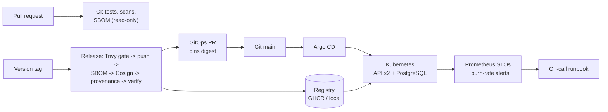

# HealthQueue - production-grade DevOps reference pipeline

Week 7 capstone. HealthQueue is a health-tech startup launching a patient-facing **appointment scheduling API**.
This repository is the engineering team's reference architecture: a small FastAPI service plus everything needed to
build, secure, deploy, observe and measure it - and it all runs **for $0 on a laptop**.

| | What | Where |
|---|---|---|
| App | FastAPI appointment API, PostgreSQL/SQLite, JSON logs, Prometheus metrics, OpenTelemetry traces, 53 tests | `app/`, `tests/` |
| CI/CD | GitHub Actions: tests, SAST, dependency audit, Trivy gate, Syft SBOM, Cosign keyless signing, SLSA provenance, verification, GitOps PR | `.github/workflows/` |
| IaC | OpenTofu: KMS, encrypted S3 evidence bucket, CloudWatch logs, GitHub OIDC role; S3 remote state with locking | `infra/` |
| GitOps | Kustomize + Argo CD (prune, self-heal) on kind; NetworkPolicies, Pod Security `restricted` | `deploy/` |
| SRE | 3 SLIs/SLOs, error budgets, burn-rate alerts (unit-tested), runbook, postmortem | `observability/`, `docs/` |
| Reports | DORA 90-day analysis + SLO/error-budget workbooks (formulas, charts, independent checks) | `reports/` |

> **Honesty note.** Nothing here was deployed to a real cloud. AWS resources are validated and *planned* against
> LocalStack, never applied. The 90-day DORA data and the 30-day SLO month are **synthetic**. Local image signatures
> use a throwaway test key; the trusted keyless signature and SLSA provenance are produced only when `release.yml`
> runs on GitHub. See [`reports/validation-report.md`](reports/validation-report.md) for exactly what was tested.

## Architecture



Full diagrams and the "tested vs. designed" table: [`docs/architecture.md`](docs/architecture.md).

## Quick start (choose a path)

First run the read-only checker; it tells you which paths your computer supports:

```powershell
powershell -ExecutionPolicy Bypass -File scripts\check_prereqs.ps1   # Windows
```
```bash
bash scripts/check_prereqs.sh                                        # macOS / Linux / Git Bash
```

### Path A - Python only (API, tests, workbooks) · ~5 minutes

```powershell
# Windows PowerShell
git clone https://github.com/FarhanOsMo/healthqueue-capstone-.git
cd healthqueue-capstone-
python -m venv .venv; .\.venv\Scripts\Activate.ps1
pip install -r requirements-dev.txt
python -m pytest --cov            # 53 tests (Postgres test skips without a database)
uvicorn app.main:app --port 8080  # http://127.0.0.1:8080/docs
```
```bash
# macOS / Linux
git clone https://github.com/FarhanOsMo/healthqueue-capstone-.git && cd healthqueue-capstone-
python3 -m venv .venv && source .venv/bin/activate
pip install -r requirements-dev.txt
python -m pytest --cov
uvicorn app.main:app --port 8080
```

Rebuild the synthetic data and both workbooks:

```bash
python scripts/generate_dora_data.py && python scripts/generate_slo_data.py
python scripts/build_dora_workbook.py && python scripts/build_slo_workbook.py
python scripts/verify_workbooks.py
```

### Path B - Docker (containers, supply chain, OpenTofu) · ~15 minutes

```bash
cp .env.example .env                       # set POSTGRES_PASSWORD to any random value
docker compose up --build -d               # API + PostgreSQL on http://127.0.0.1:8080
docker compose --profile observability up -d   # + Prometheus with the SLO rules: http://127.0.0.1:9090
docker compose down -v

bash scripts/local_supply_chain.sh         # build -> local registry -> Trivy gate -> Syft SBOM -> Cosign sign/attest -> verify -> tamper test
bash scripts/tofu_localstack_check.sh      # tofu fmt/validate -> LocalStack -> remote state -> lock test -> plan (never apply)
```

### Path C - Full Kubernetes + GitOps (kind + Argo CD) · ~15-20 minutes first time

Needs Docker with ≥ 6 GB RAM, kind and kubectl. On Windows run these in **Git Bash**.

```bash
bash scripts/kind_up.sh                            # dedicated cluster "healthqueue" + Argo CD + Gitea (own kubeconfig)
bash scripts/local_supply_chain.sh                 # signed image in the local registry
bash scripts/set_image.sh local                    # pin the signed digest in Git
bash scripts/gitops_publish.sh "initial deploy"    # Argo CD syncs from Git -> Synced / Healthy
bash scripts/gitops_verify.sh                      # 14 checks: API, digest, self-heal, commit rollout, git-revert rollback, NetworkPolicy, PSA
python scripts/measure_slis.py                     # local load test -> real SLIs
bash scripts/cleanup.sh                            # remove only this project's cluster/containers
```

Your default kubectl context is never changed (`export KUBECONFIG=$PWD/.kube/healthqueue.kubeconfig` to use the
cluster). Details: [`docs/runbooks/kubernetes-gitops.md`](docs/runbooks/kubernetes-gitops.md).

## API

| Method | Path | Result |
|---|---|---|
| GET | `/healthz` | liveness - process alive |
| GET | `/readyz` | readiness - database reachable (503 if not) |
| POST | `/v1/appointments` | `201` booked · `409` provider already booked · `422` invalid |
| GET | `/v1/appointments/{id}` | `200` · `404` · `422` malformed id |
| GET | `/v1/appointments?clinic_id=CLN-001&limit=50` | list |
| GET | `/metrics` | Prometheus metrics |

Patients are identified only by pseudonymous references (`PT-000123`); names, dates of birth and free text are
rejected. See [`docs/production-readiness.md`](docs/production-readiness.md) for what must change before real PHI.

## Results at a glance

| Area | Result (evidence in `reports/`) |
|---|---|
| Tests | 53 passed, 94% coverage (incl. PostgreSQL integration); ruff, bandit, pip-audit clean |
| Image | Trivy gate: 0 fixable HIGH/CRITICAL; SBOM 2,969 SPDX elements; signature + SBOM + provenance verified; tampered image rejected |
| IaC | fmt/validate pass (4 roots); Trivy IaC 0 HIGH/CRITICAL; plan 13 to add vs LocalStack; lock contention blocked + force-unlock tested |
| GitOps | Argo CD Synced/Healthy; self-heal, commit rollout, `git revert` rollback, NetworkPolicy, PSA all verified |
| SLOs | 99.9% -> 43.2 min/30 d; synthetic month: availability budget 91.9% used (FREEZE); load test found + fixed a latency SLO breach (85.4% -> 100% ≤ 300 ms) |
| DORA (synthetic) | 2.03 deploys/day, 7.5 h lead time, 8.2% CFR, 36 min recovery in the GitOps phase; toil per deploy -92% |

## Documentation

| Topic | Document |
|---|---|
| Architecture (Mermaid) | [docs/architecture.md](docs/architecture.md) |
| Observability, SLIs/SLOs, error budget policy | [docs/observability-plan.md](docs/observability-plan.md) |
| Supply chain + SLSA mapping | [docs/supply-chain-security.md](docs/supply-chain-security.md) |
| DORA analysis + toil | [docs/dora-analysis.md](docs/dora-analysis.md) |
| Cost safeguards, prerequisites, installs | [docs/COST_AND_PREREQUISITES.md](docs/COST_AND_PREREQUISITES.md) |
| ADRs (6) | [docs/adr/](docs/adr/) |
| Runbooks: incident, OpenTofu, Kubernetes/GitOps, local dev, reports | [docs/runbooks/](docs/runbooks/) |
| Blameless postmortem example | [docs/postmortems/](docs/postmortems/) |
| PHI production-readiness checklist | [docs/production-readiness.md](docs/production-readiness.md) |
| Rubric mapping and self-audit | [docs/rubric-mapping.md](docs/rubric-mapping.md) |
| Validation evidence | [reports/validation-report.md](reports/validation-report.md) |
| Video outline | [docs/video-walkthrough-outline.md](docs/video-walkthrough-outline.md) |
| Build log / environment | [BUILD_STATUS.md](BUILD_STATUS.md) |

## Repository settings to enable after pushing (free)

* Branch protection on `main`: require PR, 1 review, Code Owners, status checks `CI`, no force push.
* *Settings -> Actions -> General:* "Read repository contents" default token, allow Actions to create PRs (for the
  GitOps PR).
* *Settings -> Environments:* create `release` with required reviewers.
* Keep the repository **public** so Actions minutes, GHCR and artifact attestations stay free.

## Project layout

```
app/                 FastAPI service (config, models, storage, observability, main)
tests/               pytest (API, validation, storage, observability, reports) + promtool rule tests
.github/             CI, release, Dependabot, CODEOWNERS, PR template
infra/               OpenTofu module, aws-production + localstack roots, state bootstrap
deploy/              kind config, Kustomize base/overlays, Argo CD project/apps, local Gitea
observability/       Prometheus SLO recording + alert rules, scrape config
scripts/             supply chain, kind/GitOps, OpenTofu checks, data + workbook generators, verifiers, cleanup
data/                synthetic CSVs (reproducible)
reports/             workbooks + evidence from real runs
docs/                architecture, plans, ADRs, runbooks, postmortem, rubric mapping, video outline
```
