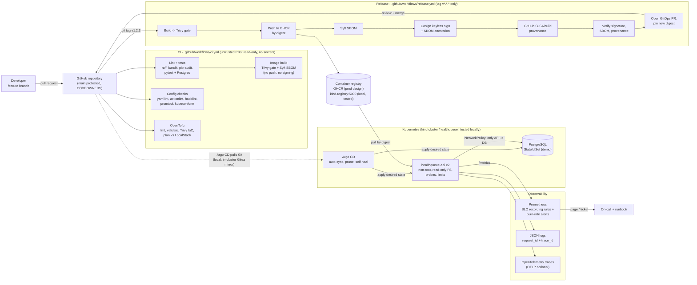
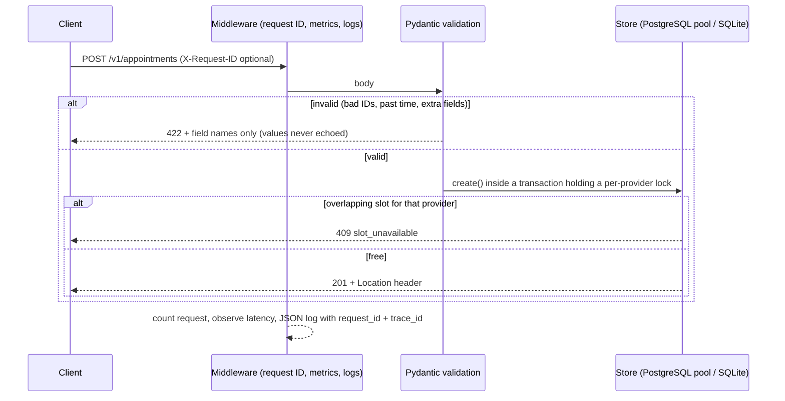
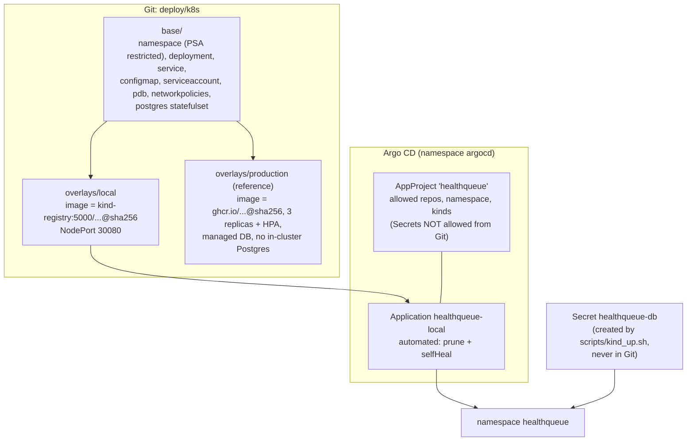
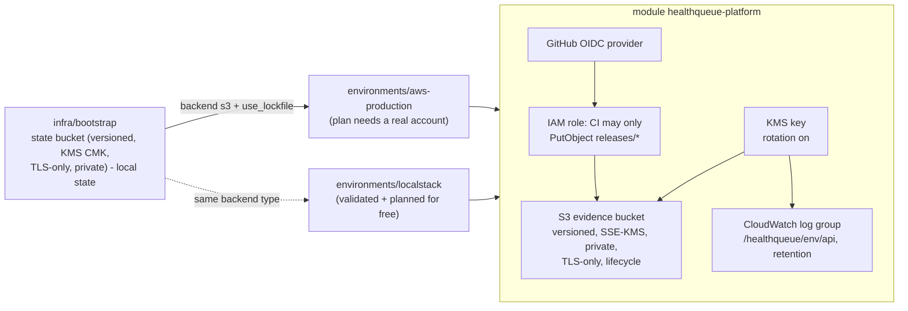

# HealthQueue architecture

This page describes what is **actually implemented** in this repository, and marks clearly which parts are a
reference design that was not deployed (because deploying them would cost money).

## 1. The big picture: from a code change to a running, observed service

**How to read it (simple version):** a developer opens a pull request; CI tests it but cannot publish
anything. When a maintainer tags a release, a separate trusted workflow builds the image, refuses to continue
if Trivy finds fixable HIGH/CRITICAL vulnerabilities, pushes it, creates an SBOM, signs it, records how it was
built (provenance), verifies all of that, and then *proposes* the new image digest in a pull request. A human
merges it, and Argo CD - not a person with `kubectl` - makes the cluster match Git. Prometheus watches the
three SLIs and pages on-call when the error budget burns too fast.

## 2. What was tested where

| Stage | Production design | What runs in this repo for $0 | Evidence |
|---|---|---|---|
| Source | GitHub, protected `main`, CODEOWNERS, PR template | Same files; protection must be enabled in repo settings | `.github/` |
| CI | GitHub Actions `ci.yml` | Same checks run locally (see README) | `reports/validation-report.md` |
| Registry | GHCR (`ghcr.io/farhanosmo/healthqueue-api`) | Local `registry:3` container `kind-registry` | `reports/supply-chain/image-ref.txt` |
| Signing | Cosign keyless (GitHub OIDC -> Fulcio, Rekor) | Cosign with a **local test key**, no transparency log | `reports/supply-chain/cosign-verify*.json` |
| Provenance | `actions/attest-build-provenance` (SLSA v1 provenance) | Local, explicitly *untrusted* provenance attestation | `reports/supply-chain/provenance.local.json` |
| Infrastructure | OpenTofu on AWS (`infra/environments/aws-production`) | `validate` + `plan` against LocalStack; **never applied** | `reports/opentofu/` |
| GitOps | Argo CD watching GitHub | Argo CD watching an in-cluster Gitea copy of this repo | `reports/k8s/gitops-verification.txt` |
| Cluster | Managed Kubernetes (not built - would cost money) | kind cluster `healthqueue` | `reports/k8s/` |
| Database | Managed PostgreSQL (encrypted, backups, Multi-AZ) | PostgreSQL StatefulSet / Compose / SQLite | tests + GitOps checks |
| Monitoring | Prometheus + Alertmanager + Grafana/OTel collector | Prometheus via Compose profile, `promtool` rule tests | `reports/observability/` |

## 3. Application

* **FastAPI** app in `app/` (`main.py` routes and middleware, `models.py` validation, `storage.py` storage,
  `observability.py` logs/metrics/traces, `config.py` settings from environment variables).
* **Storage**: SQLite for the zero-setup quick start and tests; PostgreSQL (with a connection pool) when several
  replicas must share data - see [ADR-0001](adr/0001-application-and-data-storage.md).
* **Double booking** is prevented inside the database transaction (SQLite `BEGIN IMMEDIATE`, PostgreSQL
  `pg_advisory_xact_lock` per provider), and covered by a concurrency test.
* **Privacy**: no names, dates of birth or free text. Patients are opaque references (`PT-000123`); unknown fields
  are rejected so PHI cannot sneak in.

## 4. Kubernetes and GitOps

* **Change flow:** change Git -> PR -> merge -> Argo CD syncs (default poll 30 s locally). Rollback = `git revert`.
* **Verified locally** by `scripts/gitops_verify.sh`: self-heal of manual drift, a commit scaling 2 -> 3
  replicas, a `git revert` back to 2, NetworkPolicy blocking, and Pod Security rejecting a privileged pod.
* Details and commands: [runbooks/kubernetes-gitops.md](runbooks/kubernetes-gitops.md),
  [ADR-0004](adr/0004-gitops-with-argo-cd.md).

## 5. Infrastructure as Code (reference AWS design)

Why these resources: the evidence bucket stores SBOMs, scan reports and attestations from each release (the
supply-chain audit trail a health-tech auditor will ask for); the log group stores API logs with a fixed
retention; the OIDC role lets GitHub upload evidence **without long-lived AWS keys**. The Kubernetes cluster and
database are deliberately not in OpenTofu here because creating them costs money - see
[ADR-0003](adr/0003-infrastructure-and-state-management.md).

## 6. Observability

Three SLIs (availability, latency < 300 ms, successful valid submissions) are computed from the API's own
Prometheus metrics. Recording rules pre-compute error ratios over 5m/30m/1h/6h/3d windows and multi-window
burn-rate alerts page on-call. Logs are JSON with `request_id` and `trace_id`; traces use OpenTelemetry. Full plan:
[observability-plan.md](observability-plan.md).

## 7. Security boundaries at a glance

| Boundary | Control |
|---|---|
| Untrusted PR code | `ci.yml` has `contents: read` only, no secrets, no `id-token`, `persist-credentials: false` |
| Publishing | Only `release.yml` on version tags, `environment: release` (can require approval) |
| Third-party actions | Pinned to full commit SHAs; Trivy pinned to a post-incident version by digest |
| Image | Pinned base digest, non-root UID 10001, no pip at runtime, Trivy gate |
| Cluster | PSA `restricted`, read-only root FS, drop ALL capabilities, NetworkPolicies, no SA token |
| Secrets | Never in Git: generated at bootstrap locally; External Secrets / cloud secret manager in production |
| AWS | OIDC role (no keys), write-only to one prefix, `allowed_account_ids`, KMS everywhere |

## 8. Known gaps (honest list)

* No real cloud deployment (by design, $0 budget) - production overlay and AWS environment are validated, not run.
* Keyless signing, GHCR publishing and GitHub provenance run only when the release workflow runs on GitHub
  (requires pushing the repository and a tag). Local signing uses a test key.
* No admission controller verifies signatures inside the cluster yet (planned: Sigstore policy-controller or
  Kyverno `verifyImages`) - see [supply-chain-security.md](supply-chain-security.md).
* Monitoring stack is not deployed in kind (Prometheus is demonstrated with Docker Compose).
